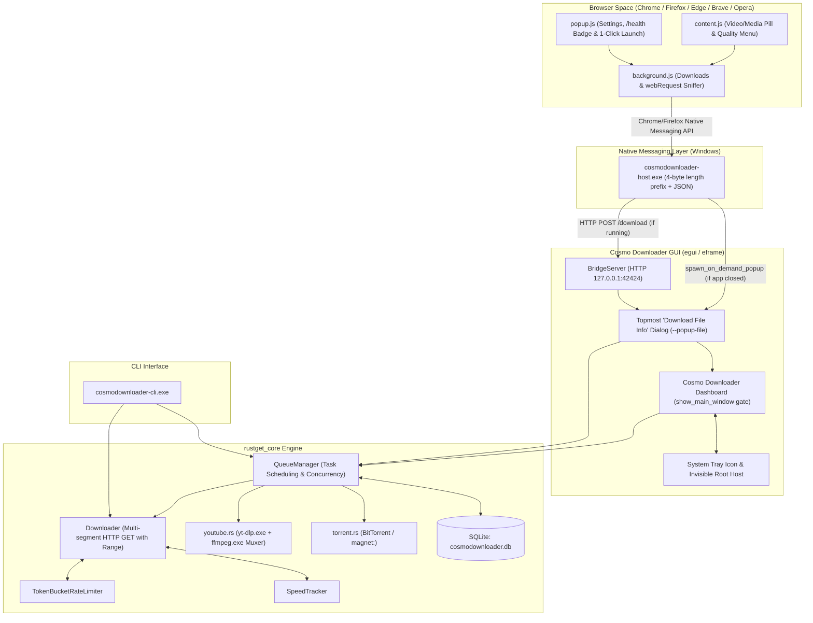

# ✦ Cosmo Downloader — Agent Mind Map & Architecture Guide

> [!IMPORTANT]
> **AGENT DIRECTIVE — DO NOT SEARCH EVERY FILE OR SCAN THE WORKSPACE RECURSIVELY!**
> Always consult this mind map before looking for or modifying code. It maps every component, file, function, and IPC pathway. Directly target the specific files you need via direct file operations (`read_file` or focused edits) rather than sweeping searches across the repository. Never scan `target/`, `dist/`, `.git/`, `node_modules/`, or binary files.

---

## ⚡ Instant File Lookup Matrix ("Where is What?")

Use this fast-lookup table to pinpoint the exact file for any feature or task:

| If You Need To Touch... | Target File / Directory | Key Structs / Functions / Constants |
| :--- | :--- | :--- |
| **Desktop GUI / Entrypoint & Host** | [`crates/app/src/lib.rs`](../crates/app/src/lib.rs) | `run`, `handle_quit_command`, `CosmoDownloaderApp` re-exports |
| **Main App State & Window Gate** | [`crates/app/src/app.rs`](../crates/app/src/app.rs) | `CosmoDownloaderApp`, `show_main_window`, `determine_launch_origin`, `LaunchOrigin`, `MainWindowReason` |
| **UI Components (Table, Nav, Toolbar)** | [`crates/app/src/components/`](../crates/app/src/components/) | `render_download_table`, `render_category_sidebar`, `render_toolbar`, `render_menu_bar`, `render_title_bar`, `render_status_bar`, `render_empty_state` |
| **IDM-style Download & Settings Dialogs** | [`crates/app/src/dialogs/`](../crates/app/src/dialogs/) | `render_download_window_content`, `DownloadWindowState`, `AddDialogState`, `OptionsDialogState` |
| **System Tray, Autostart & Win32 APIs** | [`crates/app/src/platform/`](../crates/app/src/platform/) | `build_system_tray`, `get_autostart_info`, `set_autostart_enabled`, `show_download_popup_window`, `shell_open_file`, `shell_open_folder_and_select` |
| **Steel Slate Theme & Vector Icons** | [`crates/app/src/theme/`](../crates/app/src/theme/), [`crates/app/src/icons/`](../crates/app/src/icons/) | `configure_visuals`, `palette`, `shapes` |
| **Multi-segment Chunk Downloader** | [`crates/core/src/downloader.rs`](../crates/core/src/downloader.rs) | `Downloader`, `DownloadOptions`, `DownloadProgress`, `DownloadStatus` |
| **Byte Range & Segment Division** | [`crates/core/src/segment.rs`](../crates/core/src/segment.rs) | `Segment`, `calculate_segments` |
| **URL Probing & Filename Extraction** | [`crates/core/src/probe.rs`](../crates/core/src/probe.rs) | `probe_url`, `FileInfo`, `extract_filename`, `sanitize_filename`, `resolve_unique_path` |
| **Download Queue & Concurrency** | [`crates/core/src/queue.rs`](../crates/core/src/queue.rs) | `QueueManager`, `QueueEvent` |
| **SQLite DB & Task Persistence** | [`crates/core/src/db.rs`](../crates/core/src/db.rs) | `Database`, `DownloadRecord`, migrations |
| **Local Bridge Server (IPC HTTP: 42424)** | [`crates/core/src/server.rs`](../crates/core/src/server.rs) | `BridgeServer`, `ExtensionDownloadRequest`, `spawn_on_demand_popup`, `get_or_create_bridge_token` |
| **YouTube & yt-dlp Video Extraction** | [`crates/core/src/youtube.rs`](../crates/core/src/youtube.rs) | `query_video_formats`, `query_video_formats_with_headers`, `is_youtube_url`, `is_streaming_site` |
| **BitTorrent & Magnet Handling** | [`crates/core/src/torrent.rs`](../crates/core/src/torrent.rs) | `is_torrent_url`, `is_magnet_link`, `extract_torrent_name`, `read_torrent_file_metadata` |
| **Speed Tracking & Rate Limiting** | [`crates/core/src/speed.rs`](../crates/core/src/speed.rs), [`crates/core/src/rate_limiter.rs`](../crates/core/src/rate_limiter.rs) | `SpeedTracker`, `TokenBucketRateLimiter` |
| **Clipboard, Category & Checksums** | [`crates/core/src/clipboard.rs`](../crates/core/src/clipboard.rs), [`category.rs`](../crates/core/src/category.rs), [`checksum.rs`](../crates/core/src/checksum.rs) | `ClipboardMonitor`, `Category`, `categorize`, `compute_sha256`, `verify_sha256` |
| **Core Exports & Module Tree** | [`crates/core/src/lib.rs`](../crates/core/src/lib.rs) | Public `rustget_core` re-exports, `version`, `log_event` |
| **Browser Native Messaging Host** | [`crates/native-host/src/lib.rs`](../crates/native-host/src/lib.rs) | `run`, `ExtensionMessage`, `HostResponse`, `--register`, `--unregister` |
| **Command Line Interface (CLI)** | [`crates/cli/src/lib.rs`](../crates/cli/src/lib.rs) | `Cli`, `Commands` |
| **Chromium Extension (MV3 `v1.2.7`)** | [`browser-extensions/Chrome-Edge-Brave-Opera/`](../browser-extensions/Chrome-Edge-Brave-Opera/) | `manifest.json`, `background.js`, `content.js`, `popup.js`, native host `.json`s |
| **Firefox Extension (MV3 `v1.10.4`)** | [`browser-extensions/Mozilla-Firefox/`](../browser-extensions/Mozilla-Firefox/) | `manifest.json`, `background.js`, `content.js`, `popup.js`, `com.cosmodownloader.downloader.firefox.json` |
| **Inno Setup Windows Installer** | [`installer/cosmodownloader.iss`](../installer/cosmodownloader.iss) | Inno Setup directives, registry entries, shortcuts, upgrade hooks |
| **Release Build Automation** | [`installer/build-release.ps1`](../installer/build-release.ps1) | Cargo release build, Authenticode signing, portable zip & Inno packaging |
| **Active Utility & Test Scripts** | [`scripts/`](../scripts/) | `deploy_binaries.ps1`, `sign.ps1`, `verify_signatures.ps1`, `sync-extensions.mjs`, `build_xpi.ps1`, `stress.ps1` |
| **Extension & Window Tests** | [`tests/`](../tests/), [`crates/app/tests/`](../crates/app/tests/), [`crates/core/tests/`](../crates/core/tests/) | Playwright/Node tests, `window_gate_test.rs`, `audit_tests.rs`, `integration_tests.rs` |

---

## 🏛️ System Architecture & IPC Flow



---

## 📁 Repository Directory Map

```text
cosmo_downloader/
├── .agent/                                 # Agent instructions, mind map & workspace skills
│   ├── MINDMAP.md                          # Master mind map & file lookup matrix
│   ├── INSTRUCTIONS.md                     # Agent behavior & release rules
│   ├── README.md                           # Navigation index for agents
│   └── skills/                             # Workspace skills (copy-build-to-desktop, m3-design, m3-expressive, repo-sync-and-release)
├── .agents                                 # Symlink to .agent/
├── .github/workflows/release.yml           # CI release build, Authenticode signing & verification
├── Cargo.toml                              # Workspace root (v1.2.7)
├── Cargo.lock                              # Dependency lockfile
├── package.json                            # Node/Playwright test & Stylelint scripts (v1.2.7)
├── LICENSE                                 # MIT License
├── README.md                               # User-facing documentation (v1.2.7)
├── CHANGELOG.md                            # Release history
├── RELEASE_NOTES.md                        # Current release notes (v1.2.7)
├── icon.ico                                # Main application icon (multi-resolution Windows ICO)
├── assets/                                 # Canonical SVG & PNG logo source assets
├── ffmpeg.exe                              # Bundled ffmpeg binary (gitignored)
├── yt-dlp.exe                              # Bundled yt-dlp binary (gitignored)
│
├── crates/
│   ├── app/                                # Desktop GUI (CosmoDownloader.exe)
│   │   ├── Cargo.toml, build.rs, app.rc    # Crate manifest & Windows VERSIONINFO resource
│   │   ├── tests/                          # Window gate, dialog, probe & leak integration tests
│   │   └── src/
│   │       ├── main.rs / lib.rs / app.rs   # Binary entry, bridge quit helper & CosmoDownloaderApp
│   │       ├── components/                 # download_table, empty_state, menu_bar, nav_rail, status_bar, title_bar, toolbar
│   │       ├── dialogs/                    # add_download, download_window, settings
│   │       ├── icons/                      # Vector icon helpers
│   │       ├── platform/                   # windows, unix, tray, logger, watchdog
│   │       ├── theme/                      # colors, shapes, visuals configuration
│   │       └── icon_32.rgba                # Embedded 32x32 RGBA tray icon
│   │
│   ├── core/                               # Core engine library (rustget_core)
│   │   ├── Cargo.toml
│   │   ├── tests/                          # audit_tests, formats_lookup_test, integration_tests, pause_resume_cancel_test, unicode_test
│   │   └── src/                            # category, checksum, clipboard, db, downloader, error, lib, probe, queue, rate_limiter, segment, server, speed, state, torrent, youtube
│   │
│   ├── native-host/                        # Browser Native Messaging Host (cosmodownloader-host.exe)
│   │   ├── Cargo.toml, build.rs, app.rc
│   │   └── src/                            # main.rs, lib.rs
│   │
│   └── cli/                                # Command Line Interface (cosmodownloader-cli.exe)
│       ├── Cargo.toml, build.rs, app.rc
│       └── src/                            # main.rs, lib.rs
│
├── browser-extensions/
│   ├── Chrome-Edge-Brave-Opera/            # Chromium Manifest V3 extension (v1.2.7) + Chrome/Edge/Firefox native manifests
│   └── Mozilla-Firefox/                    # Firefox Manifest V3 extension (v1.10.4) + Firefox native manifest
│
├── docs/
│   ├── TEST_CHECKLIST.md                   # Manual & automated Windows QA checklist
│   └── window-rules.md                     # Invisible host & show_main_window gate contract
│
├── installer/
│   ├── cosmodownloader.iss                 # Inno Setup script (v1.2.7)
│   ├── build-release.ps1                   # Automated release build, sign & packaging script
│   └── icon.ico                            # Installer wizard icon
│
├── scripts/                                # Active build, signing, deploy & test utilities
│   ├── build_xpi.ps1                       # Packages Firefox extension .zip / .xpi
│   ├── copy_build.ps1 / copy_build.sh      # Copies latest build to Windows Desktop
│   ├── deploy_binaries.ps1 / update-app.ps1# Atomic in-place deployment & update
│   ├── rickroll-test.mjs                   # End-to-end Playwright YouTube extension test
│   ├── sign.ps1 / verify_signatures.ps1    # Authenticode signing & verification
│   ├── stress.ps1                          # Windows UI/process race stress test
│   └── sync-extensions.mjs                 # Syncs shared JS/HTML/CSS to Mozilla-Firefox
│
├── tests/                                  # Node/Playwright extension tests & windows_smoke.ps1
└── dist/                                   # Latest v1.2.7 / Firefox v1.10.4 release artifacts
```

---

## 🔄 Core Lifecycles & Execution Flows

### 1. Browser Download Interception Flow
```text
User clicks download or video download pill in Chrome / Edge / Brave / Opera / Firefox
  │
  ▼
Extension (`background.js` / `content.js`) captures URL, cookies, referer, User-Agent, or sniffed stream
  │
  ▼
Extension sends Native Messaging payload to `cosmodownloader-host.exe` (or POSTs to `127.0.0.1:42424`)
  │ (4-byte length prefix + JSON payload)
  ▼
`cosmodownloader-host.exe`:
  ├── Attempts HTTP POST to `http://127.0.0.1:42424/download` (BridgeServer)
  │     └── If GUI is running: BridgeServer opens topmost Download File Info dialog
  └── If HTTP connection fails (GUI is closed):
        └── Calls `spawn_on_demand_popup(&dl_req)`:
              ├── Writes request JSON to `%TEMP%/cosmo_popup_<pid>_<ts>.json`
              └── Launches `CosmoDownloader.exe --popup-file <path>`
```

### 2. Multi-Segment Downloading Flow
```text
`Downloader::start` in `crates/core/src/downloader.rs`
  │
  ├── 1. Probes URL with `probe_url` (`crates/core/src/probe.rs`)
  │      └── Obtains Content-Length, Accept-Ranges, ETag, and sanitized filename
  ├── 2. Calculates byte chunks via `calculate_segments` (`crates/core/src/segment.rs`)
  ├── 3. Spawns Tokio tasks for each segment (HTTP Range, `TokenBucketRateLimiter`, `SpeedTracker`)
  ├── 4. Verifies segment completion and assembles destination file
  └── 5. Updates task record in SQLite (`crates/core/src/db.rs`) & emits `QueueEvent`
```

---

## 🚫 What NEVER To Do (Agent Rules of Engagement)

1. **NEVER run blanket recursive searches**: Do not run `grep -r`, `find .`, or directory traversals over `target/`, `dist/`, `node_modules/`, or the whole repo.
2. **NEVER parse binary files as text**: Do not attempt to `read_file` on `ffmpeg.exe`, `yt-dlp.exe`, `.ico`, `.rgba`, `.zip`, `.xpi`, or `.exe`.
3. **NEVER break Native Messaging IPC framing**: The native host relies strictly on 4-byte little-endian length prefix followed by JSON over stdin/stdout. NEVER print standard text logs to stdout in `crates/native-host/src/lib.rs` (tracing MUST log to stderr only).
4. **NEVER change the BridgeServer port (42424)** without updating `crates/core/src/server.rs`, `crates/native-host/src/lib.rs`, `crates/app/src/lib.rs`, and browser extensions consistently.
